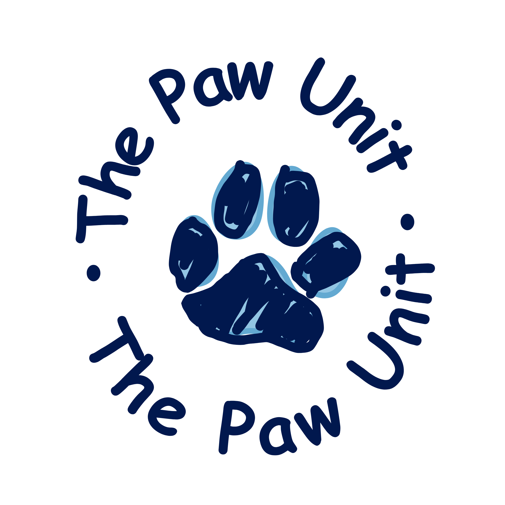

<p align="center">
  
</p>

<h1 align="center">The Software Subteam presents the Smart Mat PU-2101</h1>

> Project proposal: [MakerRepo](https://makerepo.com/project_proposals/620.interactive-dog-mat)

The **Smart Mat PU-2101** is an interactive mat, integrated with a web application, that enables two-way communication between a dog and their owner, who experiences limited mobility and dexterity.

Design for Accessibility is the focus of this project. The design of the final prototype and product must therefore: 
- Be usable comfortably and independently by the client
- Integrate all sub-systems of the mat (electrical, structural, software) without compromising the requirements

The Smart Mat is a direct application of the **Curb Cut Effect**, as it is a universal design. It benefits more than the marginalized group we originally designed and engineered for.

## How It Works

- **Frontend:** A Vite + React web app
- **Connection:** A WebSocket connection over Wi-Fi links the ESP32 and the web app and allows real-time data transfer
- **Firmware:** An Arduino sketch (C++) running on the ESP32. It acts on the app's commands and reads the four pressure pads

## Mat Protocol

The app communicates with the smart mat via Wi-Fi using WebSockets. Each message is one line of text.

| App -> mat | Meaning |
| --- | --- |
| `L1` / `L0` | Lights on / off |
| `C1` / `C0` | Calm mode on / off |
| `S` | Play a friendly sound |
| `W` | Play recall whistle |
| `P` | Play the "good dog" tune (four rising notes) |
| `X` | All off |
| `V<0-100>` | Sound volume |
| `B<0-100>` | Light brightness |
| `?` | Report status |

| Mat -> app | Meaning |
| --- | --- |
| `MODEL:<model>` | Mat model (for example `PU-2101`), shown in Settings |
| `VOL:<0-100>` | Current volume (sent on connect and after a `V` command) |
| `PLAY:1` / `PLAY:0` | A pressure pad is pressed / none pressed, used for hours played |
| `PAD<1-4>:1` / `PAD<1-4>:0` | Pressure pad 1 to 4 pressed / released |
| `ACTIVE:<0-4>` | Which pad is active (the highest-numbered pressed pad), 0 for none |

The app also understands `BAT:<0-100>` (battery level), but the current firmware doesn't send it.

The mat listens on port 8080 and announces itself as `smartmat.local`.

## Wiring (ESP32)

| Pin | Part |
| --- | --- |
| GPIO 18 | WS2812 LED strip (data in) |
| GPIO 25 | Speaker amplifier (in) |
| GPIO 34 | Pressure pad 1 (yellow) |
| GPIO 35 | Pressure pad 2 (red) |
| GPIO 33 | Pressure pad 3 (green) |
| GPIO 32 | Pressure pad 4 (blue) |

## Getting Started
### Firmware config

1. Install the [Arduino IDE](https://www.arduino.cc/en/software).
2. Add ESP32 support: open the **Boards Manager**, search for **esp32** by Espressif Systems, and install it. This also provides the built-in `WiFi` and `ESPmDNS` libraries.
3. Open the **Library Manager** and install **WebSockets** (by Markus Sattler) and **Adafruit NeoPixel**.
4. Open `arduino/smart_mat/smart_mat.ino`.
5. In the same folder, copy `secrets.example.h` to `secrets.h` and enter your Wi-Fi name and password. The ESP32 only works with 2.4 GHz Wi-Fi. `secrets.h` is ignored by git, so your password is never committed.
6. Select your ESP32 board (a classic ESP32, since the speaker output uses the built-in DAC on GPIO 25) and its port, then click **Upload**.
7. Open the **Serial Monitor** at 115200 baud. Once the mat connects to Wi-Fi, it prints its IP address and its `smartmat.local` name. You'll need one of them to connect from the app.

### Webapp local setup
1. Ensure your smart mat is running and connected to the same Wi-Fi network.
2. Navigate to the frontend subfolder:
   ```
   cd frontend
   ```

3. (Only do this once) Install dependencies and start the app:
   ```
   npm install
   ```

4. Run the application:
   ```
   npm run dev
   ```

5. Open the app at http://localhost:5173/ in your browser, click **Connect via Wi-Fi**, and enter the mat's IP address or `smartmat.local`.

---

<div align="center">
    Built as part of <b>GNG2101 (Product Development for Engineers and Computer Scientists)</b>, Fall 2026
</div>